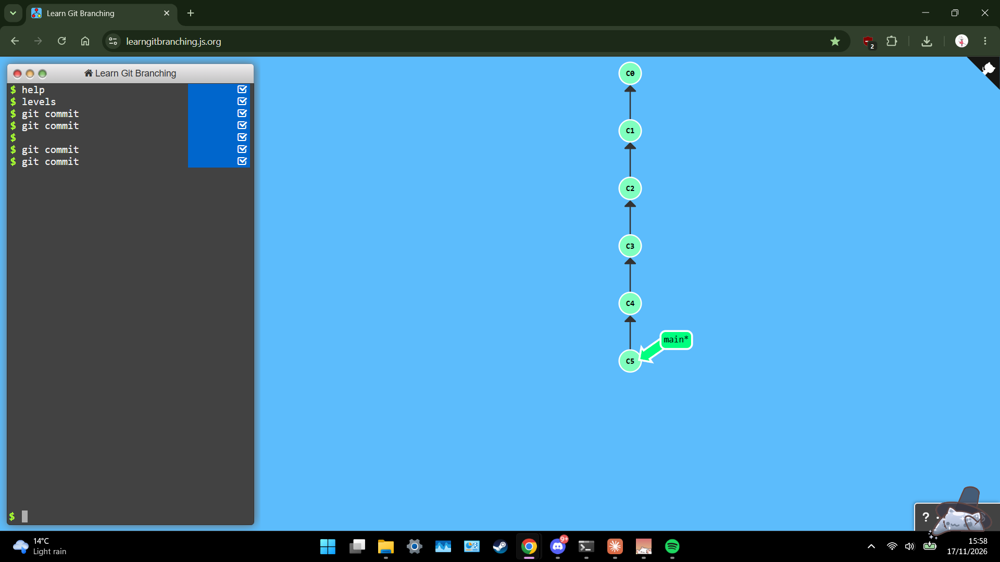
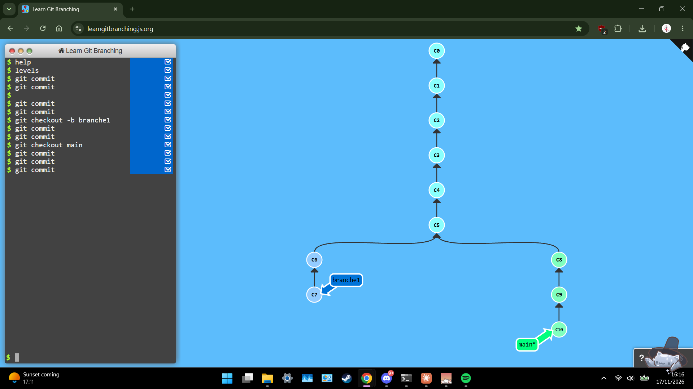
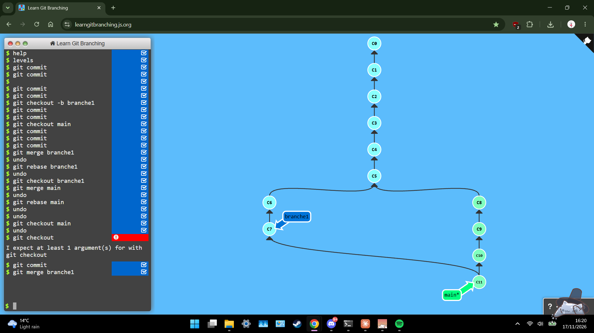

Ok git c'est beau c'est joli c'est cool, mais c'est pas facile.  
Vous pouvez voir les commits de git comme des snapshot de votre dossier a l'instant t  
Et vous pouvez voir les branches comme des pointeurs sur ces commits
  
Ici le main pointe vers le commit C5  

Pour cloner un repo git sur votre pc, vous faites git clone NOM_DU_REPO  
Ensuite vous pouvez travailler dessus, et pour creer un nouveau commit, on ajoute les fichiers avec git add .  
Puis on cree le commit avec git commit -m "Message qui dit vous avez fait kwa"  
Puis ensuite, vous pouvez push votre commit en faisant git push  
Ca va juste rajouter votre commit a la suite du commit precedent et boujer le pointeur de la branches

Vu que on peut travailler a plusieurs sur un meme repo, imaginons que tu travailles sur un commit mais que quelqun d'autre a push un commit a la suite, tu es donc en retard de x commit  
Tu peux soit faire un git pull --rebase pour rajouter les modifs (et choisir ce que tu veux garder si il a modifie les meme fichiers que toi)  
Soit mettre des modifs de cote en faisant git stash, se mettre a jour avec git pull --rebase, et remettre les modifs que tu avait en faisant git stash pop  
Puis le usuel git add . git commit git push

# Les branches
C'est la ou git c'est fort, le fait de pouvoir creer des branches  
Pour creer la branche a partir du commit actuel, on fait git checkout -b NOM_DE_BRANCHE  
Puis on peut changer de branche en faisant git switch NOM_DE_BRANCHE ou git checkout NOM_DE_BRANCHE  
Maintenant que on a developpe a plusieurs sur plusieurs branches en meme temps, on veux pouvoir combiner notre travail.  
  
Ici on a 2 branches, le main et la branche branche1  
Si on veut creer un nouveau commit qui contient les 2, on se place sur main, puis on merge branche1 en faisant git merge branche1  
  
On voit que on a cree un nouveau commit, et que main pointe desormais vers le nouveau commit  

Vous pouvez vous entrainer a faire des branches sur [Learn Git Branching](https://learngitbranching.js.org/)  
Si vous avez des questions ya une doc bien faite [ici](https://training.github.com/downloads/fr/github-git-cheat-sheet.pdf) et [ici](https://www.youtube.com/watch?v=dQw4w9WgXcQ)  
